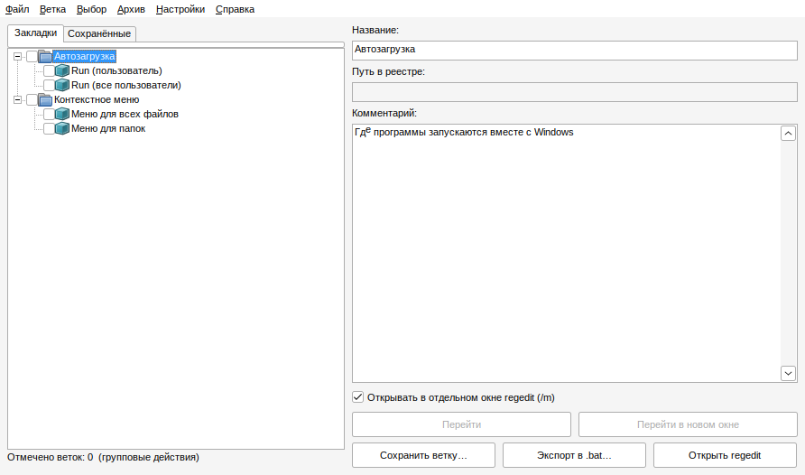

# Key Shelf Reg Jumper

*(до версии 0.2 — KeyShelf)* · **RU** · [EN below](#english)

Небольшая портативная программа для Windows 7–10: закладки на ветки реестра с папками и комментариями,
быстрый переход в `regedit`, сохранение веток в `.reg` с историей, экспорт в `.bat` / `.vbs`, сравнение состояния
реестра «до / после», наблюдение за изменениями онлайн, «держать от изменений» и правка веток в текстовом редакторе.
Один exe-файл, без установки и без внешних библиотек (чистый Win32 API, C). Вся функциональность доступна и из
командной строки (`/?`).



## Возможности

- **Закладки с папками.** Вложенные папки на любом уровне, комментарий к каждой папке и ветке,
  переименование (`F2`), перетаскивание мышью (внутрь папки, между элементами, на верхний уровень).
- **Переход в regedit** двойным кликом / `Enter`. Можно открывать в **отдельном окне** (`regedit.exe /m`),
  чтобы работать с несколькими ветками одновременно. Отдельные команды «просто открыть regedit»
  (в месте, где он был закрыт) обычным способом или в новом окне.
- **Взять ветку из открытого regedit** (`Ctrl+G`): путь текущей ветки берётся из окна regedit, затем её можно
  добавить в закладки, сохранить в `.reg`, использовать в снимке, экспортировать в скрипт, поставить на наблюдение,
  держать от изменений или править в редакторе. Запасной путь: «Копировать имя раздела» в regedit и та же команда.
- **Добавление из `.reg`-файлов**: через меню (`Ctrl+O`), перетаскиванием файла на окно или через пункт
  в контекстном меню `.reg` (включается в «Настройки», права администратора не нужны).
- **Сохранение веток в `.reg`** (`Ctrl+S`) через штатный `reg export`: в архив программы (папка `Saved`
  рядом с exe, с иерархией папок) или в любую другую папку. В имени файла — дата, время и ваша заметка.
  Вкладка **«Сохранённые»**: просмотр, переименование, перенос, удаление (в корзину), «Восстановить в реестр».
- **Групповые операции.** Отметьте несколько веток флажками и сохраните их отдельными файлами или одним `.reg`.
- **Экспорт в `.bat` и `.vbs`**: скрипт открывает regedit на нужной ветке. Имена: `NO-HKLM_SOFTWARE_...bat`
  (обычное открытие: уже открытый regedit закрывается и запускается заново) или `NW-HKLM_SOFTWARE_...bat`
  (новое окно, `/m`). То же для `.vbs`.
- **Правка в текстовом редакторе.** Ветка выгружается в `Saved\tmp`, открывается в редакторе по умолчанию (Блокнот),
  в `notepad.exe` или в выбранном редакторе. Оригинал сохраняется рядом (`*.orig.reg`), поэтому ошибку в правках можно
  откатить. После правки: «Восстановить в реестр». Временная папка очищается при выходе (можно отключить).
- **Сравнение реестра (вкладка «Сравнение»).** Снимки веток или целых разделов (`HKLM`, `HKCU`, `HKU`) с датой и
  временем, сравнение любых двух снимков или снимка с текущим состоянием, список различий «было / стало» и текстовый
  отчёт. Снимки хранятся на диске и переживают перезагрузку. «Шумные» ветки исключаются по списку
  `snapshot_exclude.txt`.
- **Наблюдение онлайн (вкладка «Наблюдение»).** Каждое изменение (добавлено, удалено, изменено, с блоками «было / стало»)
  появляется в списке и записывается в лог (папка `Watch`).
- **Держать от изменений (вкладка «Защита»).** Список веток (всей веткой или только сам ключ). Программа следит за
  ними и при изменении или удалении возвращает исходное состояние, записывая каждое событие в лог защиты
  (`Watch\protect.log`). Можно запускать автоматически при старте программы.
- **Единый файл настроек и закладок** `keyshelf.cfg` (старые `keyshelf.ini` и `keyshelf.ksl` переносятся автоматически).
- **Лог** (`keyshelf.log`) можно отключить в «Настройки».

## Командная строка

Справка: `KeyShelfRegJumper.exe /?`. Если программа запущена из CMD, PowerShell, BAT-файла или по SSH, вывод идёт в
консоль (перенаправление `>` и конвейеры работают, кодировка UTF-8). Для скриптов удобна **консольная версия**
`KeyShelfRegJumper_cli_*.exe`: оболочка дожидается её завершения, а вывод не смешивается с приглашением.

| Ключ | Что делает |
|---|---|
| `/nogui`, `/noui` | только консоль, никаких окон |
| `/jump ветка`, `/jumpm ветка` | открыть regedit на ветке (обычно / в новом окне) |
| `/goto "имя"`, `/add ветка ["имя"] ["папка/подпапка"]`, `/list` | закладки |
| `/addreg файл.reg` | добавить ветки из `.reg` (с `/nogui` — без окна выбора) |
| `/export ветка... файл.reg`, `/saveto ветка... ["заметка"]` | выгрузка в файл / в архив с датой и заметкой |
| `/bat`, `/export-bat`, `/vbs`, `/export-vbs ветка... [NO\|NW\|BOTH] [папка]` | скрипты открытия ветки |
| `/open`, `/open-notepad`, `/open-with редактор.exe` + ветка, `/apply`, `/import файл.reg`, `/clean-tmp` | правка в редакторе и импорт |
| `/snap`, `/snaps`, `/cmp старый новый\|current [отчёт]` | снимки и сравнение |
| `/watch [секунды] ветка...` | наблюдение, события в консоль в реальном времени |
| `/hold [секунды] [ветка...] [/norec]` | держать от изменений |
| `/probe`, `/log on\|off`, `/cfg файл`, `/yes`, `/version` | прочее |

`NO` (Normal Open) — обычный режим: уже открытый regedit закрывается и запускается заново на ветке. `NW` (New Window) —
новое окно `regedit /m`, остальные окна не трогаются. `BOTH` — оба варианта. Коды выхода: 0 — успех, 1 — ошибка
выполнения, 2 — неверные параметры, 3 — не найдено.

## Скачать

Готовые exe — в разделе [Releases](../../releases): `KeyShelfRegJumper_x64.exe` / `_x86.exe` (окно; 64- и 32-битная
Windows) и `KeyShelfRegJumper_cli_x64.exe` / `_cli_x86.exe` (консольная версия для скриптов). Файлы не подписаны
цифровой подписью, поэтому SmartScreen или антивирус могут показать предупреждение. Исходный код открыт, можно собрать
самостоятельно.

## Сборка

Релизные exe собираются автоматически в GitHub Actions (`.github/workflows/build.yml`): каждый push
собирает проект, а тег вида `v0.5` создаёт релиз с exe-файлами и контрольными суммами.

Локально из Linux (Debian/Ubuntu):

```sh
sudo apt install gcc-mingw-w64-x86-64 gcc-mingw-w64-i686 binutils-mingw-w64
./build.sh
```

## Где хранятся данные

Рядом с exe: `keyshelf.cfg` (настройки, закладки, список защиты), `keyshelf.log` (лог), `snapshot_exclude.txt` (список
исключений для сравнения), папки `Saved` (в т.ч. `Saved\tmp`), `Bat`, `Snapshots`, `Reports`, `Watch`. Если папка
программы недоступна для записи — в `%APPDATA%\KeyShelf`.

## Ограничения и состояние проекта

- Версия 0.5. Разработка велась кросс-компиляцией под Linux, интерфейс и движок проверялись в Wine; на реальных
  Windows 7–10 проверено ограниченно, возможны ошибки.
- «Держать от изменений»: для веток `HKLM` нужны права администратора; права доступа (ACL) к веткам не восстанавливаются;
  исходным состоянием считается состояние на момент запуска защиты.
- Часть веток (например, `SAM`, `SECURITY`) недоступна для чтения даже администратору: такие ветки пропускаются.
- Снимок целого раздела может занять от десятков секунд до нескольких минут и много места на диске; наблюдение за целым
  разделом создаёт заметную нагрузку.
- Сравнение и наблюдение показывают **что** изменилось, но не **какой процесс** это сделал.
- Чтение ветки из окна открытого regedit проверено ограниченно; если не сработало, используйте «Копировать имя раздела».
- Сообщения об ошибках приветствуются (приложите последние строки `keyshelf.log`).

## Лицензия

MIT, см. [LICENSE](LICENSE).

---

## English

**Key Shelf Reg Jumper** (formerly KeyShelf) is a small portable Windows 7–10 tool: registry key bookmarks with
folders and comments, quick jump into `regedit` (optionally in a separate window via `regedit.exe /m`), saving keys to
`.reg` with history, `.bat` / `.vbs` launchers, before/after registry comparison, live registry watching, **"hold from
changes"** (automatic restore of protected keys, with a log) and editing keys in a text editor (originals kept for
rollback). Single exe, no installer, no external libraries (pure Win32 API, C). Everything is also available from the
command line (`/?`): output goes to the console when started from CMD/PowerShell/BAT/SSH, `/nogui` forbids any window, and
a dedicated console build (`KeyShelfRegJumper_cli_*.exe`) is provided for scripts.

`NO` = Normal Open (an already running regedit is closed and reopened at the key), `NW` = New Window (`regedit /m`),
`BOTH` = both variants. Exit codes: 0 ok, 1 runtime error, 2 bad arguments, 3 not found.

**Download:** see [Releases](../../releases) (unsigned executables; SmartScreen/antivirus may warn). **Build:** `./build.sh`
with mingw-w64, or GitHub Actions on every push / tag. **Status:** v0.5, tested mostly under Wine; limited testing on real
Windows. HKLM protection needs administrator rights. It shows *what* changed, not *which process* changed it.
Licensed under MIT.
