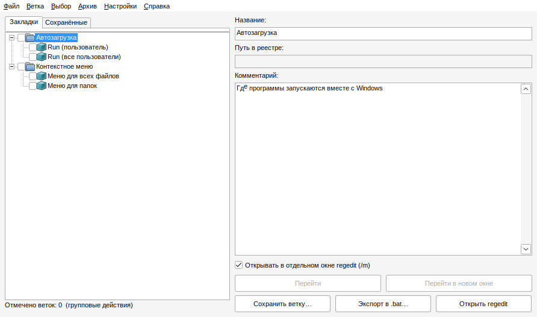

# Key Shelf Reg Jumper

*(до версии 0.2 — KeyShelf)* · **RU** · [EN below](#english)

Небольшая портативная программа для Windows 7–10: закладки на ветки реестра с папками и комментариями,
быстрый переход в `regedit`, сохранение веток в `.reg` с историей, экспорт в `.bat` и **сравнение состояния
реестра «до / после»** (например, до и после установки программы) и **наблюдение за изменениями онлайн**. Один exe-файл, без установки и без внешних
библиотек (чистый Win32 API, C).



## Возможности

- **Закладки с папками.** Вложенные папки на любом уровне, комментарий к каждой папке и ветке,
  переименование (`F2`), перетаскивание мышью (внутрь папки, между элементами, на верхний уровень).
- **Переход в regedit** двойным кликом / `Enter`. Можно открывать в **отдельном окне** (`regedit.exe /m`),
  чтобы работать с несколькими ветками одновременно. Отдельные команды «просто открыть regedit»
  (в месте, где он был закрыт) обычным способом или в новом окне.
- **Добавление из `.reg`-файлов**: через меню (`Ctrl+O`), перетаскиванием файла на окно или через пункт
  в контекстном меню `.reg` (включается в «Настройки», права администратора не нужны).
- **Сохранение веток в `.reg`** (`Ctrl+S`) через штатный `reg export`: в архив программы (папка `Saved`
  рядом с exe, с иерархией папок) или в любую другую папку. В имени файла — дата, время и ваша заметка.
  Вкладка **«Сохранённые»**: просмотр, переименование, перенос, удаление (в корзину), «Восстановить в реестр».
- **Групповые операции.** Отметьте несколько веток флажками и сохраните их отдельными файлами или одним `.reg`.
- **Экспорт в `.bat`**: скрипт открывает regedit на нужной ветке. Имена: `NO-HKLM_SOFTWARE_...bat`
  (обычное открытие) или `NW-HKLM_SOFTWARE_...bat` (новое окно, `/m`).
- **Сравнение реестра (вкладка «Сравнение»).** Делаете **снимок** выбранных веток или целых разделов
  (`HKLM`, `HKCU`, `HKU`), устанавливаете программу, делаете ещё один снимок (или сравниваете с текущим
  состоянием) и получаете список различий: добавленные и удалённые ветки, добавленные, удалённые и
  изменённые значения с блоками «было / стало». Снимки хранятся на диске (папка `Snapshots`) с датой и временем,
  переживают перезагрузку, сравнивать можно любые два снимка. Текстовый отчёт сохраняется в папку `Reports`.
  «Шумные» ветки, которые Windows меняет сама, исключаются по списку `snapshot_exclude.txt` (его можно править).
- **Наблюдение онлайн (вкладка «Наблюдение»).** Выбираете ветки (из закладок, целые разделы или свои), и каждое
  изменение (добавлено, удалено, изменено, с блоками «было / стало») появляется в списке и записывается в лог
  наблюдения (папка `Watch`). Windows сообщает, что в ветке что-то изменилось, но не называет процесс, поэтому
  программа пересчитывает ветку и показывает разницу.
- **Взять ветку из открытого regedit** (`Ctrl+G`): открываете regedit, переходите на нужную ветку, и программа
  берёт её путь и предлагает: в закладки, сохранить в `.reg`, в снимок для сравнения, экспорт в `.bat` или в наблюдение.
  Если прочитать окно regedit не удаётся (например, он запущен от администратора), работает запасной путь: в regedit
  «Копировать имя раздела», затем та же команда.
- **Единый файл настроек и закладок** `keyshelf.cfg` (раньше были `keyshelf.ini` и `keyshelf.ksl`; при первом запуске
  новой версии они переносятся автоматически, старые файлы остаются как `.bak`).
- **Лог** (`keyshelf.log`) можно отключить в «Настройки».

## Скачать

Готовые exe — в разделе [Releases](../../releases): `KeyShelfRegJumper_x64.exe` (64-битная Windows),
`KeyShelfRegJumper_x86.exe` (32-битная). Файлы не подписаны цифровой подписью, поэтому SmartScreen или
антивирус могут показать предупреждение. Исходный код открыт, можно собрать самостоятельно.

## Сборка

Релизные exe собираются автоматически в GitHub Actions (`.github/workflows/build.yml`): каждый push
собирает проект, а тег вида `v0.3` создаёт релиз с exe-файлами и контрольными суммами.

Локально из Linux (Debian/Ubuntu):

```sh
sudo apt install gcc-mingw-w64-x86-64 gcc-mingw-w64-i686 binutils-mingw-w64
./build.sh
```

## Для скриптов

```
KeyShelfRegJumper.exe /snap снимок.ksn "название" ветка [ветка ...]   # снимок указанных веток
KeyShelfRegJumper.exe /cmp старый.ksn новый.ksn отчёт.txt            # сравнить два снимка
KeyShelfRegJumper.exe /watch секунд ветка [ветка ...]                 # наблюдать N секунд, события в Watch\*.log
```

## Где хранятся данные

Рядом с exe: `keyshelf.cfg` (настройки и закладки), `keyshelf.log` (лог), `snapshot_exclude.txt` (список исключений для
сравнения), папки `Saved`, `Bat`, `Snapshots`, `Reports`, `Watch`. Если папка программы недоступна для записи — в `%APPDATA%\KeyShelf`.

## Ограничения и состояние проекта

- Версия 0.4. Разработка велась кросс-компиляцией под Linux, интерфейс и движок сравнения проверялись в Wine;
  на реальных Windows 7–10 проверено ограниченно, возможны ошибки.
- Часть веток (например, `SAM`, `SECURITY`) недоступна для чтения даже администратору: такие ветки пропускаются.
- Снимок целого раздела может занять от десятков секунд до нескольких минут и много места на диске.
- Сравнение и наблюдение показывают **что** изменилось, но не **какой процесс** это сделал.
- Наблюдение за целым разделом реестра создаёт заметную нагрузку (при каждом изменении пересчитывается часть раздела);
  для точечного слежения выбирайте конкретные ветки.
- Чтение ветки из окна открытого regedit проверено только в ограниченном виде; если не сработало, используйте «Копировать имя раздела».
- Сообщения об ошибках приветствуются (приложите последние строки `keyshelf.log`).

## Лицензия

MIT, см. [LICENSE](LICENSE).

---

## English

**Key Shelf Reg Jumper** (formerly KeyShelf) is a small portable Windows 7–10 tool: registry key bookmarks with
folders and comments, quick jump into `regedit` (optionally in a separate window via `regedit.exe /m`), saving keys
to `.reg` with history, `.bat` launchers, and **before/after registry comparison** (e.g. before and after installing
software). Single exe, no installer, no external libraries (pure Win32 API, C).

**Comparison:** take a *snapshot* of chosen keys or whole hives (HKLM/HKCU/HKU), install something, take another
snapshot (or compare with the live registry) and get a diff: added/removed keys, added/removed/changed values with
"was / now" blocks. Snapshots are stored on disk with date and time (they survive reboots), any two can be compared,
and a text report is saved to `Reports`. Noisy keys are excluded via an editable `snapshot_exclude.txt`.

**Other features:** nested bookmark folders with comments, drag & drop, jump to key (same or new window), add keys
from `.reg` files, save keys through `reg export` into an archive, group save via checkboxes, `.bat` export
(`NO-…` normal / `NW-…` new window), switchable log, **live registry watching** (changes with "was / now" shown in a list and written to a log), **"take the current key from an open regedit"** (`Ctrl+G`, with a clipboard fallback), and a **single config file** `keyshelf.cfg` (old `.ini` + `.ksl` are migrated automatically).

**Download:** see [Releases](../../releases) (`KeyShelfRegJumper_x64.exe`, `KeyShelfRegJumper_x86.exe`; unsigned,
SmartScreen/antivirus may warn). **Build:** `./build.sh` with mingw-w64, or GitHub Actions on every push / tag.
**Status:** v0.4, tested mostly under Wine; limited testing on real Windows. It shows *what* changed, not *which
process* changed it. Licensed under MIT.
